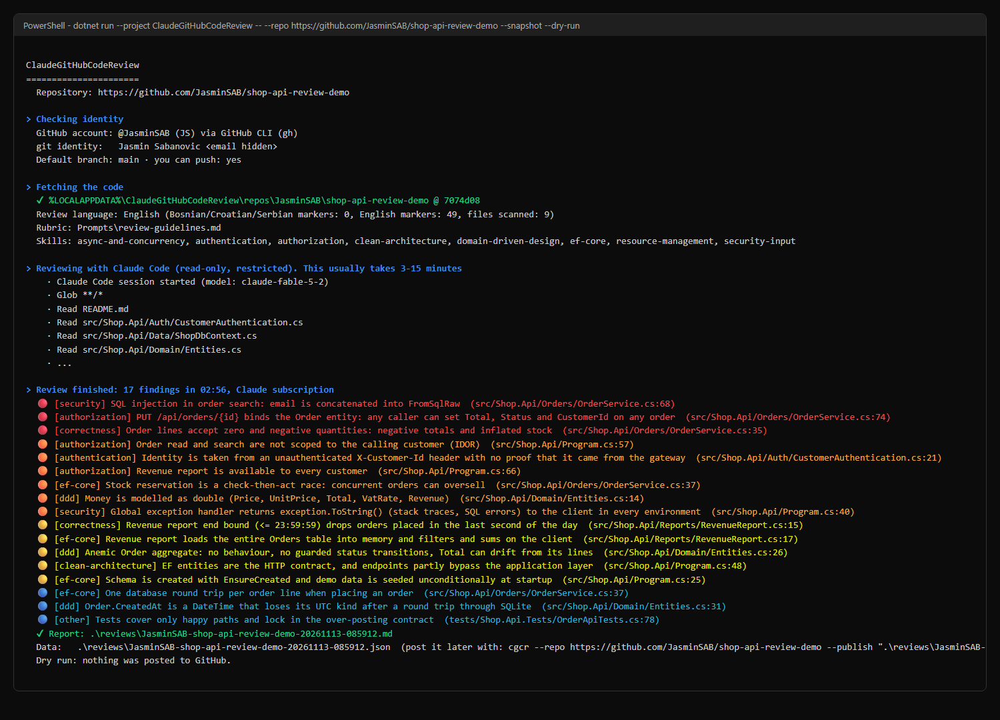
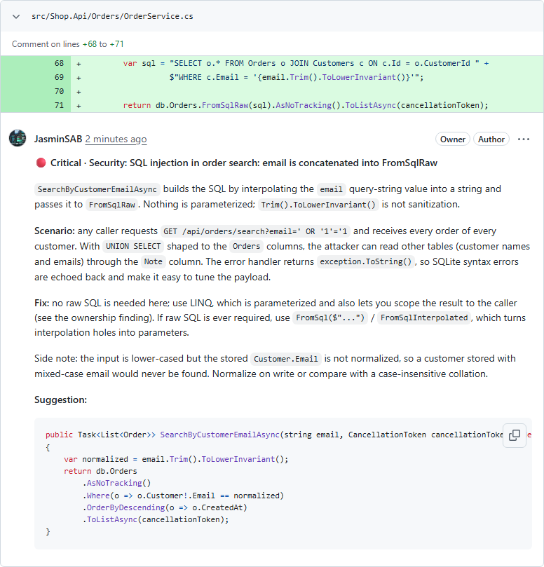

# ClaudeGitHubCodeReview (`cgcr`)

AI code review for **any GitHub repository**, posted **as you**, with comments **in the language your
team writes in**.

You start the app, paste the URL of the repository you want reviewed, and `cgcr`:

1. shows which GitHub account and git identity it will act as (the login already on your machine),
2. lets you pick an open pull request, **or reviews the whole existing codebase when there is no PR**,
3. runs [Claude Code](https://docs.claude.com/en/docs/claude-code) headless and read-only, using **review skills**:
   security, authentication, authorization, EF Core, async and concurrency, resource management, DDD and
   Clean Architecture (choose them with `--skills`, or add your own),
4. writes a local Markdown + JSON report,
5. after you confirm, posts one GitHub review with inline comments on the exact lines.

If the codebase is written in Bosnian (comments, docs, commit messages), the review is written in
Bosnian; otherwise in English. Any other language can be forced with `--language`.

> This is an MMP (minimum marketable product): small, but meant to be cloned and used as-is.
> How it was designed and why: [docs/how-it-was-built.md](docs/how-it-was-built.md).

## See it in action

[shop-api-review-demo](https://github.com/JasminSAB/shop-api-review-demo) is a small ASP.NET Core shop API
that compiles without warnings and passes its tests, but hides **eight** problems. `cgcr` reviewed it
blind, before the answer key existed, and found **all eight** in under three minutes, plus nine more
real issues nobody planted. The answer key, with one test per problem, is in
[FINDINGS.md](https://github.com/JasminSAB/shop-api-review-demo/blob/main/FINDINGS.md).

| Hidden problem | Found as |
|---|---|
| SQL injection in the email search | critical |
| Over-posting: the PUT body is the entity | critical |
| IDOR: any customer reads any order | high |
| Lost update: concurrent orders oversell the stock | high |
| Money in `double` (7.50 + 17% VAT = 8.77, not 8.78) | high |
| Stack traces returned to the client | high |
| Revenue report loads the whole table into memory | medium |
| `<= 23:59:59` drops the last second of the day | medium |

The run (`--snapshot --dry-run`):



The review posted to [pull request #3](https://github.com/JasminSAB/shop-api-review-demo/pull/3), one comment on the exact lines:



---

## Prerequisites

| Tool | Why | Check |
|---|---|---|
| [.NET SDK 10](https://dotnet.microsoft.com/download) | build and run `cgcr` | `dotnet --version` |
| git | clone the repository being reviewed | `git --version` |
| [Claude Code CLI](https://docs.claude.com/en/docs/claude-code), logged in | the review engine | `claude --version`, then run `claude` once to log in |
| A GitHub login (one of the options below) | read private repositories, post the review | see below |

GitHub login (the first one found is used):

1. a `GH_TOKEN` or `GITHUB_TOKEN` environment variable,
2. the [GitHub CLI](https://cli.github.com/): `gh auth login`,
3. git's credential helper, e.g. Git Credential Manager on Windows (the login git already uses for `git clone`/`git push`).

`cgcr` shows the account it found before doing anything, and **every comment and pull request is
created under that account**. Your git `user.name`/`user.email` are used for the helper commits.
Public repositories can be reviewed with `--dry-run` without any GitHub login.

Token permissions needed:

| Action | Permission |
|---|---|
| review (read the code, list PRs) | read access to the repository |
| post a review on a PR | *Pull requests: write* |
| review a codebase with no PR (snapshot mode) | additionally *Contents: write*, to push two helper branches. Without it, `cgcr` offers to use a fork |

## Quick start

```bash
git clone <url of this repository>
cd ClaudeGitHubCodeReview
dotnet run --project ClaudeGitHubCodeReview
```

The app asks for the repository URL. `https://github.com/owner/repo`, `git@github.com:owner/repo.git`
and `owner/repo` are all accepted:

```
ClaudeGitHubCodeReview
=================
  GitHub repository URL (e.g. https://github.com/owner/app): https://github.com/contoso/booking-api
  Repository: https://github.com/contoso/booking-api

> Checking identity
  GitHub account: @you via GitHub CLI (gh)
  git identity:   Your Name <you@example.com>
  Default branch: main · you can push: yes
  What should be reviewed?
    1) Whole codebase of the default branch (snapshot)
    2) PR #42: Add refund endpoint (@teammate)
  Choose [1]: 2

> Fetching the code
  Review language: English (Bosnian/Croatian/Serbian markers: 3, English markers: 412, files scanned: 120)

> Reviewing with Claude Code (read-only, restricted). This usually takes 3-15 minutes
    · Read src/Orders/OrderService.cs
    · Grep IsInRole
    ...
> Review finished: 14 findings in 04:12, Claude subscription
  🔴 [authorization] ...
  ✔ Report: ./reviews/contoso-booking-api-20261109-163000.md

> About to post to GitHub
  Post one review on https://github.com/contoso/booking-api/pull/42 with up to 40 inline comments as @you
  Continue? (y/N):
```

When the repository has no open pull request, the existing codebase is reviewed as a whole (see
[below](#reviewing-a-codebase-without-a-pull-request)).

**Reviewing the same repository often?** Set `CGCR_DEFAULT_REPO` and the prompt is pre-filled, so
you only press Enter:

```bash
# Windows (PowerShell, permanent for your user)
[Environment]::SetEnvironmentVariable("CGCR_DEFAULT_REPO", "https://github.com/owner/app", "User")
# macOS / Linux
export CGCR_DEFAULT_REPO=https://github.com/owner/app
```

### Recommended flow: review first, post later

A review that is posted under your name should be read first.

```bash
# 1. Review only. Nothing is written to GitHub.
dotnet run --project ClaudeGitHubCodeReview -- --repo https://github.com/owner/app --dry-run

# 2. Read reviews/owner-app-<timestamp>.md. If you agree, post exactly that review:
dotnet run --project ClaudeGitHubCodeReview -- --repo https://github.com/owner/app --publish reviews/owner-app-<timestamp>.json
```

`--publish` does not call the model again, so what you read is exactly what gets posted.

### Build a standalone executable

```bash
dotnet publish ClaudeGitHubCodeReview -c Release -o out
out/cgcr --help          # Windows: out\cgcr.exe --help
```

## Usage

```
cgcr [options]

Target:
  --repo <url>              GitHub repository, e.g. https://github.com/owner/app or owner/app
                            (asked at launch when omitted; $CGCR_DEFAULT_REPO pre-fills the prompt)
  --pr <number>             review an open pull request
  --snapshot                review the whole codebase of the default branch (no PR needed)

Review:
  --language <auto|en|bs|name>  language of the comments (default auto: follows the codebase)
  --focus "<text>"          extra instructions appended to the rubric
  --guidelines <file>       replace the core rubric
  --skills <a,b,...>        review only with these skills (default: all)
  --skills-dir <dir>        add your own skill files; same name replaces a built-in skill
  --list-skills             show the available skills and exit
  --max-findings <n>        upper bound of findings (default 25)
  --model <name>            Claude model alias or id (default: your Claude Code default)
  --effort <level>          low | medium | high | xhigh | max
  --max-budget <usd>        stop the review if it would cost more than this
  --timeout <minutes>       default 45

Publishing:
  --dry-run                 do not touch GitHub; only write reviews/*.md and reviews/*.json
  --publish <report.json>   post a previously generated report
  --max-comments <n>        inline comments per review; the rest go in the summary (default 40)
  --fork                    if you cannot push, create the snapshot PR in your fork without asking
  -y, --yes                 do not ask for confirmation before posting
  --non-interactive         never prompt (needs --repo or CGCR_DEFAULT_REPO; posting needs --yes)

Other:
  --output <dir>            report directory (default ./reviews)
  --workdir <dir>           clone cache (default %LOCALAPPDATA%/ClaudeGitHubCodeReview/repos)
```

Examples:

```bash
# Interactive: asks for the URL and what to review
cgcr

# Review PR #12, comments in English regardless of the codebase language
cgcr --repo owner/app --pr 12 --language en

# Force Bosnian comments
cgcr --repo owner/app --language bs

# Whole codebase, extra focus, cost cap, no prompts (e.g. in CI)
cgcr --repo owner/app --snapshot --focus "multi-tenancy isolation" --max-budget 5 --non-interactive --yes

# Your own rubric (other stack or other priorities)
cgcr --repo owner/app --guidelines ./my-rubric.md
```

## Reviewing a codebase without a pull request

GitHub only accepts line comments on a pull request diff. When there is no PR, `cgcr` creates one
that contains the whole codebase as its diff, **without touching your default branch**:

```
main@abc1234 ──► code-review/<ts>/baseline   (one commit: delete every file)
                         └──► code-review/<ts>/snapshot   (revert of that commit = main@abc1234 again)

Draft PR: snapshot → baseline   ⇒ every file shows as "added", every line can be commented
```

The PR is a draft marked **do not merge**. After the review has been discussed, close it and delete
the two `code-review/...` branches.

## Getting the best reviews

* **Describe the domain in the target repository.** The reviewer reads `CLAUDE.md`, `README*`,
  `TODO*` and docs first. Write down the business rules that are intentional, so they are not
  reported as defects. This is the biggest lever on review quality.
* **Pick or write the skills** (`Prompts/skills/`) that match your stack and priorities.
* Use `--focus` for a one-off emphasis ("payment flow", "multi-tenancy", "performance of reports").

## Skills

A skill is one Markdown file that tells the reviewer what to look for in one area. The core rubric
(`Prompts/review-guidelines.md`: understand the domain first, severity scale, comment style) is always
used; the skills decide what is reviewed. Built in, in `Prompts/skills/`:

| Skill | Looks for |
|---|---|
| `security-input` | SQL built from strings, paths from user input, secrets, error output, CORS |
| `authentication` | cookies and tokens, passwords, lockout, sessions, user enumeration |
| `authorization` | fallback policy, resource ownership (IDOR), over-posting, antiforgery |
| `ef-core` | over-fetching, client-side filtering, N+1, indexes, concurrency tokens, date ranges |
| `async-and-concurrency` | `async void`, sync over async, cancellation, fire and forget, shared state, races |
| `resource-management` | `HttpClient` per request, undisposed resources, lifetimes, unbounded caches |
| `domain-driven-design` | anemic models, invariants, value objects, money and time |
| `clean-architecture` | dependency direction, thin controllers, use cases, testability |

```bash
cgcr --list-skills                                      # what is available
cgcr --repo owner/app --skills security-input,ef-core   # only these two
cgcr --repo owner/app --skills-dir ./review-skills      # add your own
```

### Write your own skill

Put a Markdown file in a folder and pass the folder with `--skills-dir`. The file name is the skill name;
a file with the same name as a built-in skill replaces it. The first heading is the title, and the
`Use for:` line is what `--list-skills` shows. For example, a team whose domain is written in Bosnian:

```markdown
# Bosnian domain language

Use for: names and messages in a codebase whose domain is written in Bosnian.

- Domain types and properties keep their Bosnian names (`Narudzba`, `Racun`, `Kupac`); do not suggest English renames.
- User-facing messages are in Bosnian; flag English strings that reach the user.
- Money is in KM with two decimals; flag `double` for amounts.
```

## Customising

| What | Where |
|---|---|
| Core rubric (approach, severity scale, comment style) | `ClaudeGitHubCodeReview/Prompts/review-guidelines.md`; copied next to the executable and editable after build; or `--guidelines` |
| What to review, one file per area | `ClaudeGitHubCodeReview/Prompts/skills/*.md`; choose with `--skills`, add your own with `--skills-dir` |
| Project-specific context (business rules, decisions) | the **target** repository's `CLAUDE.md` / `README.md` |
| Headings the tool adds (severity names, "Summary", PR text) | `ClaudeGitHubCodeReview/Publishing/Labels.cs` (English, Bosnian) |
| Language detection | `ClaudeGitHubCodeReview/Review/LanguageDetector.cs` |
| Output schema | `ClaudeGitHubCodeReview/Review/ReviewModels.cs` (`ReviewSchema.Json`) |

## Safety

* The repository under review is treated as **untrusted input**. Claude Code runs with
  `--restricted` (no shell or code execution, no web access, the repo's own `.claude` settings and
  hooks are ignored), `--strict-mcp-config`, and only the read-only tools `Read`, `Grep`, `Glob`.
* Nothing is posted without an explicit confirmation (or `--yes`). Reviews are posted as `COMMENT`,
  never as *approve* or *request changes*.
* No credentials are stored by `cgcr`. The token is read at runtime from your existing login and passed
  to git through environment variables, never on the command line or in `.git/config`.
* Reports in `reviews/` can quote private source code, so they are git-ignored.

## Development

```bash
dotnet build ClaudeGitHubCodeReview.slnx
dotnet test ClaudeGitHubCodeReview.slnx
```

```
ClaudeGitHubCodeReview/
  Program.cs                    entry point, error handling, Ctrl+C
  ReviewWorkflow.cs             the use case, step by step
  Cli/                          options parsing, console prompts
  GitHub/                       REST client, URL parsing, diff-line mapping
  Infrastructure/               process runner, git wrapper
  Review/                       prompt, language detection, Claude Code runner, result schema
  Publishing/                   snapshot PR, review posting, Markdown formatting, labels
  Prompts/review-guidelines.md  the core rubric
  Prompts/skills/               one review skill per file
tests/ClaudeGitHubCodeReview.Tests/  unit tests (xUnit)
docs/how-it-was-built.md        design notes and decisions
```
